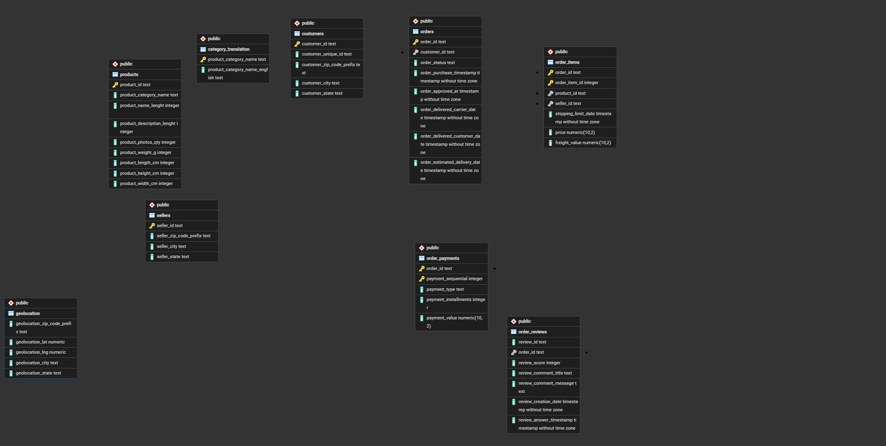
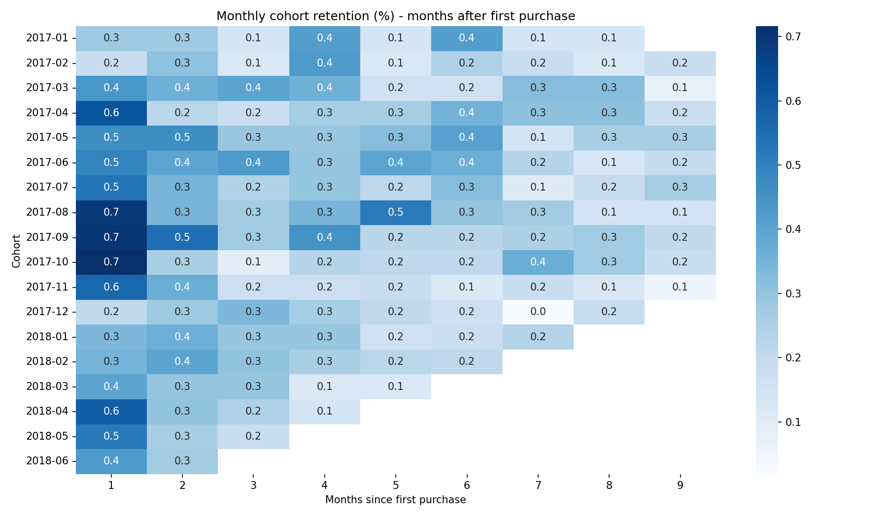
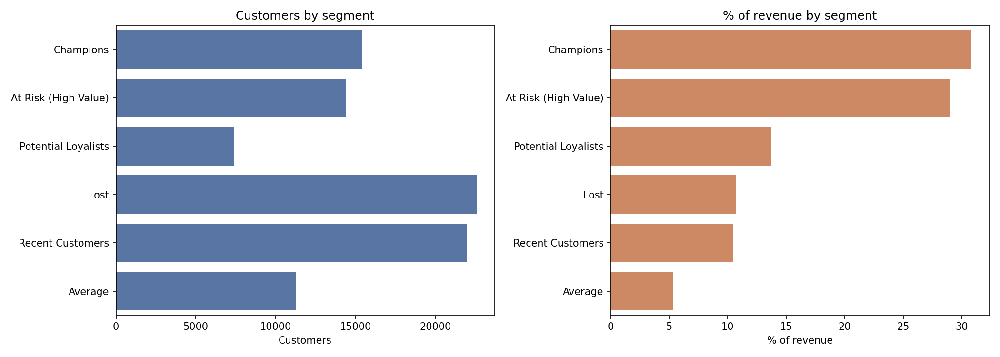
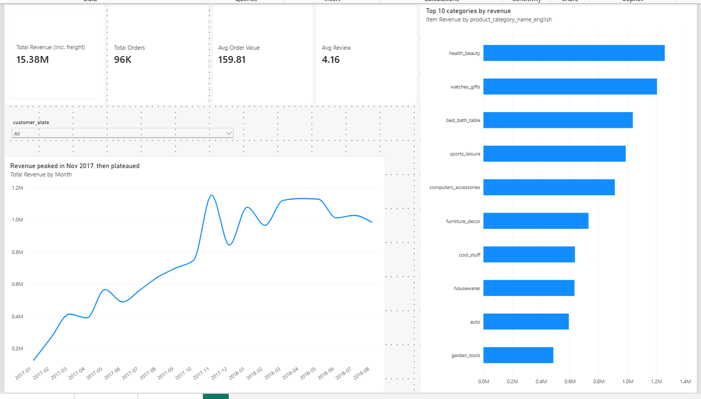
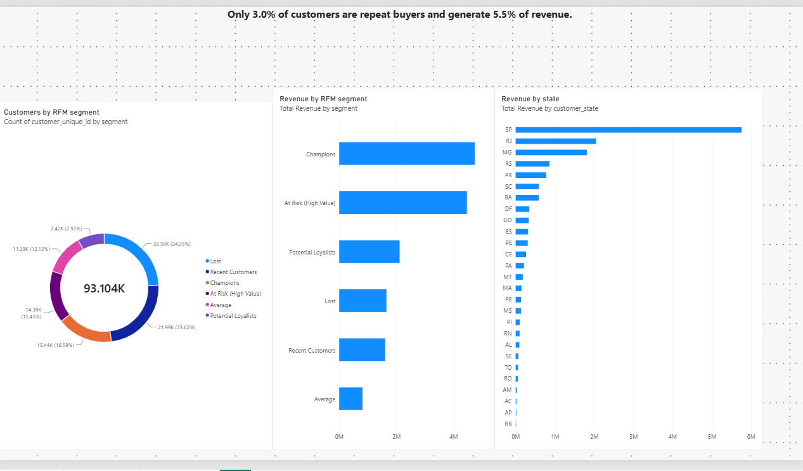
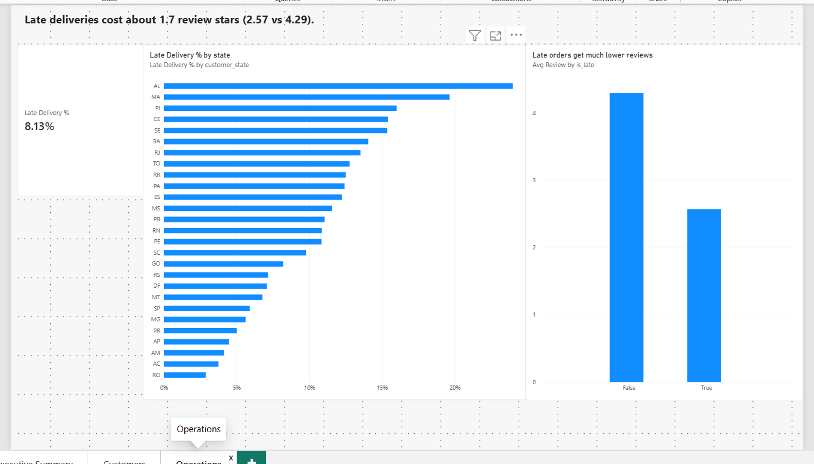

# Olist E-Commerce Analytics: SQL, Python and Power BI

End-to-end analytics project on a Brazilian e-commerce dataset (about 100k orders, 9 related tables): PostgreSQL database design, SQL analysis, customer segmentation in Python, and a 3-page Power BI dashboard.

## Business problem
Revenue growth stalled in 2018. Which customers, categories, regions and operational issues explain it, and what should the business do about it?

## Key findings
- **97% of customers buy only once.** Repeat buyers (3.0%) generate just 5.5% of revenue; cohort retention is below 1% every month.
- **Late deliveries cost about 1.7 review stars** (2.57 vs 4.29). 8% of orders arrive late.
- **Revenue plateaued in 2018** at roughly 1.0M to 1.13M per month after fast growth in 2017.
- **SP, RJ and MG generate about 63% of item revenue.**
- **Credit cards make up about 78% of payment value**, with 3.5 installments on average.

Full details and recommendations: [insights.md](insights.md)

## Dataset
[Brazilian E-Commerce Public Dataset by Olist](https://www.kaggle.com/datasets/olistbr/brazilian-ecommerce) (Kaggle). Not included in this repo.

| Table | Rows |
|---|---|
| customers | 99,441 |
| orders | 99,441 |
| order_items | 112,650 |
| order_payments | 103,886 |
| order_reviews | 99,224 |
| products | 32,951 |
| sellers | 3,095 |
| category_translation | 71 |
| geolocation | 1,000,163 |

## Tools
PostgreSQL 18, pgAdmin, SQL (CTEs, window functions, cohort analysis), Python (pandas, SQLAlchemy, seaborn, matplotlib), Power BI, VS Code, Git.

## Database design

`customer_id` is generated per order, so `customer_unique_id` is used to identify real customers.

## Data cleaning decisions
See [cleaning_notes.md](cleaning_notes.md). In short:
- Revenue and delivery analysis uses delivered orders only (96,478 of 99,441).
- 8 delivered orders without a delivery date are excluded from delivery metrics.
- 610 products have no category and are grouped as "unknown".
- Analysis window: **1 Jan 2017 to 31 Aug 2018** (2016 is sparse; Sep to Oct 2018 is incomplete).

## SQL analysis
All queries are in [`sql/`](sql/):

| File | Purpose |
|---|---|
| `01_create_tables.sql` | Schema with primary and foreign keys |
| `02_data_checks.sql` | Data quality checks |
| `03_business_questions.sql` | Q1 to Q8 business questions |
| `04_views.sql` | `vw_orders_clean` view used by Power BI |

Business questions: monthly revenue and growth, top categories, repeat vs one-time customers, cohort retention, lifetime value by state, delivery performance vs reviews, lowest-rated sellers, payment methods.

## Python analysis
[`notebooks/olist_analysis.ipynb`](notebooks/olist_analysis.ipynb): RFM segmentation (6 segments), repeat-purchase rates by segment, and a cohort retention heatmap.

## Power BI dashboard
File: [`dashboard/olist_dashboard.pbix`](dashboard/olist_dashboard.pbix)

**Executive Summary**

**Customers**

**Operations**

## How to reproduce
1. Install PostgreSQL and create a database named `olist`.
2. Download the dataset from Kaggle and place the 9 CSV files in `data/`.
3. Run `sql/01_create_tables.sql`, then load each CSV (customers, sellers, category_translation, products, orders, order_items, order_payments, order_reviews, geolocation).
4. Run `sql/04_views.sql` to create `vw_orders_clean`.
5. In `notebooks/olist_analysis.ipynb`, replace `YOUR_PASSWORD` in the connection string with your PostgreSQL password, then run all cells.
6. Open `dashboard/olist_dashboard.pbix` in Power BI Desktop and refresh the data source.

## Limitations
- No cost data in Olist, so profit margin cannot be calculated.
- Late delivery and low reviews are associated, but causation is not proven.
- Dashboard revenue (15.38M) includes freight; item-price revenue in Q2, Q3 and Q5 is about 13.2M.

## Author
Roopali Sharma | [LinkedIn](https://linkedin.com/in/roopali-sharma-514901255) | sharmaroopali042@gmail.com
